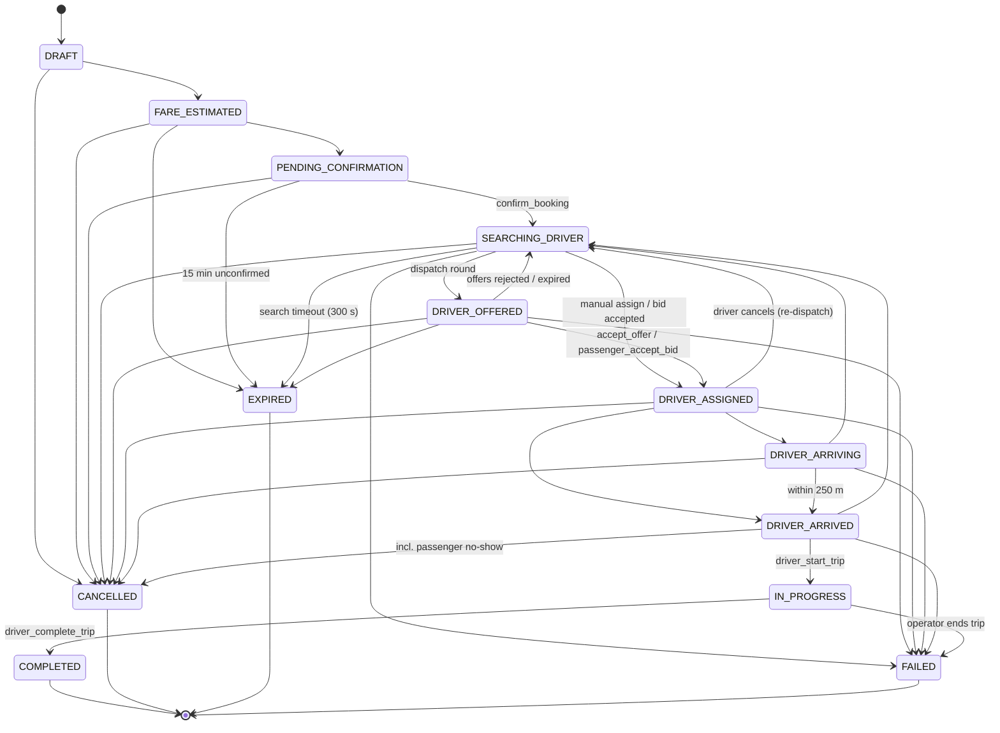

# Booking lifecycle

The state machine is defined once in SQL (`public.booking_transition_allowed`) and mirrored in
`packages/shared/src/booking-state.ts`; a unit test parses the SQL and fails on any drift.

## Enforcement

* `bookings.status` can only change inside `public._transition_booking`, which takes the row lock,
  checks `booking_transition_allowed`, updates, and appends `booking_events`
  (`from_status, to_status, actor_id, actor_role, metadata, created_at`).
* A `BEFORE UPDATE OF status` trigger rejects any other status write — even from the service role —
  unless the transaction-local flag set by `_transition_booking` matches the row.
* Inserts must start in `DRAFT`.
* API roles have no `UPDATE` privilege on `bookings` at all (tested: `t04_client_status_write_blocked`).

## Who can trigger what

| Transition | RPC | Caller |
|---|---|---|
| create → PENDING_CONFIRMATION | `create_booking` | passenger (idempotent per key) |
| → SEARCHING_DRIVER | `confirm_booking` | passenger / staff / system |
| → DRIVER_OFFERED / back to SEARCHING | `dispatch_booking`, `run_dispatch_maintenance` | system (cron, service role) |
| → DRIVER_ASSIGNED | `accept_offer`, `passenger_accept_bid`, `admin_assign_driver` | driver / passenger / ops |
| → DRIVER_ARRIVING / ARRIVED / IN_PROGRESS / COMPLETED | `driver_mark_arriving`, `driver_mark_arrived` (fresh GPS near pickup), `driver_start_trip` (ride PIN), `driver_complete_trip` | assigned driver only |
| → CANCELLED | `passenger_cancel_booking`, `driver_cancel_booking` (no-show), `admin_cancel_booking` | party / ops |
| → SEARCHING_DRIVER after assignment | `driver_cancel_booking` | assigned driver |
| → EXPIRED | `run_dispatch_maintenance` | system |
| IN_PROGRESS → FAILED | `admin_cancel_booking` | ops (`bookings.cancel`) |

## Fees and fares

* **Cancellation fee** (`fare_rules.cancellation_fee_minor`) applies when the passenger cancels more
  than `cancellation_grace_seconds` after assignment, or when the driver declares a no-show at least
  `trip.no_show_wait_minutes` after arrival. A pending payment row is created for the fee.
* **Final fare** = `compute_fare(rule, billed_distance, real_duration, stops, waiting)` where billed
  distance is the GPS track (fixes with accuracy ≤ 50 m) when it covers ≥ 70 % of the estimate,
  capped at 1.6× the estimate; otherwise the estimate. Bid-agreed rides are fixed-price.
* Commission is charged on the gross fare; promotions are platform-funded.

## Idempotency

`bookings(passenger_id, idempotency_key)` is unique; `create_booking` returns the existing booking
for a repeated key. The web client generates one key per confirm intent and reuses it on retries.
Verified under concurrency by the integration test (two simultaneous calls → one booking).
