# Database schema

PostgreSQL on Supabase with PostGIS (`extensions` schema). Source of truth: `supabase/migrations/`.
Generated TypeScript types: `packages/database/src/types.ts`.

Conventions: UUID primary keys (`gen_random_uuid()`), `created_at`/`updated_at` (trigger),
money as `bigint` minor units + `currency_code`, geography `Point/MultiPolygon` SRID 4326,
GiST indexes on every queried geography, explicit FK delete rules.

## Entity-relationship diagram

```mermaid
erDiagram
  AUTH_USERS ||--|| PROFILES : "1:1"
  PROFILES ||--o| PASSENGERS : ""
  PROFILES ||--o| DRIVERS : ""
  PROFILES ||--o{ USER_ROLES : has
  ROLES ||--o{ USER_ROLES : ""
  ROLES ||--o{ ROLE_PERMISSIONS : ""
  PERMISSIONS ||--o{ ROLE_PERMISSIONS : ""
  FLEETS ||--o{ DRIVERS : employs
  FLEETS ||--o{ FLEET_DRIVERS : ""
  DRIVERS ||--o{ VEHICLES : owns
  DRIVERS |o--o| VEHICLES : "current vehicle"
  VEHICLE_CATEGORIES ||--o{ VEHICLES : ""
  DRIVERS ||--o{ DRIVER_DOCUMENTS : uploads
  DRIVERS ||--o| DRIVER_LOCATIONS : "latest fix"
  DRIVERS ||--o{ LOCATION_HISTORY : ""
  PROFILES ||--o{ SAVED_LOCATIONS : ""
  GEOFENCES ||--o{ GEOFENCE_EVENTS : ""
  VEHICLE_CATEGORIES ||--o{ FARE_RULES : priced_by
  GEOFENCES |o--o{ FARE_RULES : "zone override"
  PROMOTIONS ||--o{ COUPONS : ""
  COUPONS ||--o{ COUPON_REDEMPTIONS : ""
  PROFILES ||--o{ FARE_ESTIMATES : requests
  FARE_RULES ||--o{ FARE_ESTIMATES : ""
  FARE_ESTIMATES |o--o| BOOKINGS : seeds
  PROFILES ||--o{ BOOKINGS : "passenger"
  DRIVERS |o--o{ BOOKINGS : "assigned driver"
  BOOKINGS ||--o{ BOOKING_STOPS : ""
  BOOKINGS ||--o{ BOOKING_EVENTS : "state history"
  BOOKINGS ||--o{ BOOKING_OFFERS : dispatch
  BOOKINGS ||--o{ BOOKING_ASSIGNMENTS : ""
  BOOKINGS ||--o{ BOOKING_BIDS : bidding
  BOOKINGS ||--o| TRIPS : ""
  TRIPS ||--o{ TRIP_LOCATIONS : "GPS track"
  TRIPS ||--o{ TRIP_WAYPOINTS : ""
  BOOKINGS ||--o{ FARE_BREAKDOWNS : ""
  BOOKINGS ||--o{ RATINGS : ""
  BOOKINGS ||--o{ PAYMENTS : ""
  PAYMENTS ||--o{ PAYMENT_TRANSACTIONS : ""
  PAYMENTS ||--o{ REFUNDS : ""
  BOOKINGS ||--o| DRIVER_EARNINGS : ""
  BOOKINGS ||--o| PLATFORM_COMMISSIONS : ""
  DRIVER_SETTLEMENTS ||--o{ DRIVER_EARNINGS : settles
  DRIVERS ||--o{ CASH_RECONCILIATION : ""
  BOOKINGS ||--o| CHAT_CONVERSATIONS : ""
  CHAT_CONVERSATIONS ||--o{ CHAT_MESSAGES : ""
  PROFILES ||--o{ NOTIFICATIONS : ""
  PROFILES ||--o{ EMERGENCY_CONTACTS : ""
  BOOKINGS |o--o{ SAFETY_INCIDENTS : ""
  BOOKINGS |o--o{ COMPLAINTS : ""
  WHATSAPP_CONVERSATIONS ||--o{ WHATSAPP_MESSAGES : ""
```

## Tables by domain

| Domain | Tables |
|---|---|
| Identity | `profiles`, `passengers`, `drivers`, `driver_documents`, `vehicles`, `vehicle_categories`, `fleets`, `fleet_drivers`, `roles`, `permissions`, `role_permissions`, `user_roles` |
| Location | `saved_locations`, `driver_locations`, `location_history`, `address_aliases`, `geofences`, `geofence_events`, `qls_lookup_cache`, `qls_usage` |
| Bookings | `bookings`, `booking_stops`, `booking_events`, `booking_offers`, `booking_assignments`, `booking_bids`, `trips`, `trip_locations`, `trip_waypoints`, `ratings` |
| Pricing | `fare_rules`, `fare_estimates`, `fare_breakdowns`, `promotions`, `coupons`, `coupon_redemptions` |
| Payments | `payments`, `payment_transactions`, `refunds`, `driver_earnings`, `driver_settlements`, `platform_commissions`, `cash_reconciliation` |
| Communication | `notifications`, `chat_conversations`, `chat_messages`, `realtime_events`, `whatsapp_conversations`, `whatsapp_messages`, `whatsapp_outbox` |
| Safety | `emergency_contacts`, `safety_incidents`, `complaints` |
| Administration | `audit_logs`, `configuration_settings` |

## Key constraints

| Constraint | Purpose |
|---|---|
| `bookings (passenger_id, idempotency_key)` unique | no duplicate bookings on retry |
| `bookings_one_active_per_passenger` (partial unique) | one ride in flight per passenger |
| `bookings_one_active_per_driver`, `booking_assignments_one_active_per_booking/driver` | no double allocation |
| `booking_offers_one_pending_per_driver` | a driver holds one offer at a time |
| `fare_rules_active_uq` | one active rule per category × currency × zone |
| `drivers_online_requires_approval` check | only approved drivers can be online |
| `driver_documents_path_owner` check | storage path must be under the driver's folder |
| `driver_earnings_math` check | `net = gross − commission` |
| `payments (provider, provider_reference)` unique | callback/verification idempotency |
| `ratings (booking_id, direction)` unique | one rating each way |

## Spatial indexes

GiST on `driver_locations.location`, `bookings.pickup`, `address_aliases.location`, `geofences.area`,
`qls_lookup_cache.location`. Dispatch uses `ST_DWithin(geography, geography, metres)` which is index-assisted.

## Configuration (`configuration_settings`)

Typed via `config_int/numeric/bool/text`; editable in Admin → Fares & config (audited). Keys:
`dispatch.*` (strategy, radius, timeouts, freshness, broadcast size), `booking.*`, `fare.*`
(estimate TTL, road factor, fallback speed, GPS billing coverage/cap), `bidding.*`, `gps.*`, `trip.*`.
`is_public` keys are readable by signed-in clients; the rest by admins only.

## Migrations

| # | File | Content |
|---|---|---|
| 0001 | extensions_and_types | PostGIS, pgcrypto, enums, money/point helpers, hardened `public` |
| 0002 | identity | RBAC, profiles, drivers, vehicles, documents, auth trigger, role helpers |
| 0003 | location | saved places, aliases, geofences, driver positions/history |
| 0004 | pricing | fare rules, promotions, coupons, estimates, breakdowns |
| 0005 | bookings | bookings, stops, events, offers, assignments, bids, trips, ratings |
| 0006 | payments | payments, transactions, refunds, earnings, settlements, commissions, cash |
| 0007 | comms_safety_admin | notifications, chat, realtime log, WhatsApp, safety, audit, config, QLS cache/usage |
| 0008 | booking_engine | state machine, fare engine, coupons, estimates, booking/confirm/cancel |
| 0009 | dispatch | eligibility, strategies, offers, accept/reject, bidding, maintenance |
| 0010 | driver_and_trip_ops | onboarding, duty, GPS ingestion, trip lifecycle, final fare, ratings, SOS, read models |
| 0011 | admin_ops | audited admin RPCs, dashboard stats, live map |
| 0012 | rls_and_grants | RLS on all tables, privileges, policies |
| 0013 | realtime | private topic authorisation, broadcast triggers |
| 0014 | storage | buckets + object policies |
| 0015 | reference_data | roles, permissions, categories, starting fares, config, Monrovia service area |
| 0016 | scheduled_jobs | pg_cron dispatch (5 s) + retention |
| 0017 | lockdown_function_privileges | fixes advisor findings (internal functions, default privileges) |
| 0018 | fix_anon_category_policy | anonymous category listing |
| 0019 | app_read_models | lat/lng read RPCs, driver dashboard, landmarks, promotions |
| 0020 | urlsafe_share_token | hex share tokens |
| 0021 | staff_read_emergency_contacts | SOS handling |
| 0022 | payments_and_whatsapp_engine | verified payment state RPCs, WhatsApp helpers + outbox |
